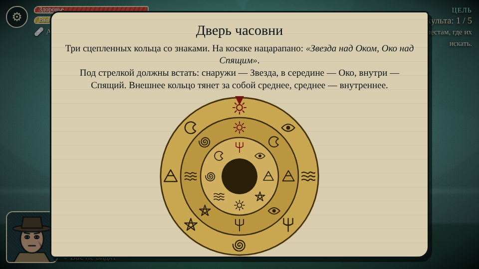

# Зов из тумана

3D-сюжетная хоррор-игра по мотивам рассказа Г. Ф. Лавкрафта «Зов Ктулху». Прототип на 8–10 минут.

Журналист Эдвард Крейн приезжает в рыбацкую деревню Грейхейвен, где по слухам пропадают приезжие. Ночь, туман, мотель на окраине — и подслушанный разговор о том, что он станет следующей жертвой.


## Как запустить

Откройте `index.html` в браузере — игра целиком в одном файле, сборка и сервер не нужны. Лучше со звуком и на весь экран.

Чтобы выложить онлайн: **Settings → Pages → Branch: main, папка / (root)**. Игра откроется по ссылке вида `https://beknazarberikbosyn-dot.github.io/-/`.

## Управление

| Клавиша | Действие |
|---|---|
| WASD / стрелки | движение |
| Shift | бег (тратит выносливость) |
| C | пригнуться — за ящиками, бочками и лодками вас не видно |
| E | действие / осмотреть |
| ЛКМ или J | удар |
| ПКМ или K | блок (вовремя — парирование) |
| F | толчок; после двух ударов подряд — нокаут |
| Q | аптечка |
| Tab | блокнот |
| Esc / ⚙ | настройки |
| колесо мыши | приближение камеры |

## Что в игре

- **Вступление** — поездка через рощу с телефонным разговором, субтитрами и бормотанием вместо голоса.
- **Мотель** — враждебные жители, подслушивание через дыру в стене от первого лица, побег через окно.
- **Деревня** — вид сверху; часовня, кладбище, маяк, рыбный склад, порт.
- **Два типа врагов** — жители с палками (с ними можно драться) и культисты в робах с факелами (только бежать или прятаться, ходят группами).
- **6 загадок от первого лица** — барельеф, кольца-шифр, координаты Р'льеха, звёзды на обелиске, идолы, сейф. Каждая открывает часть истории культа.
- **7 пасхалок** по «Зову Ктулху» — Некрономикон, профессор Энджелл, «Алерт» и «Эмма», Йохансен, Мискатоникский университет и другие.
- **Финал** — алтарь на пирсе, заклинание, Ктулху поднимается из моря, титры.
- **Настройки** — громкость, качество, туман, сложность, размер субтитров, контур, штриховка, тряска экрана.





## Устройство

Без библиотек и ассетов: собственный WebGL-рендер (low-poly, рисованный контур, штриховка теней, туман), вся геометрия строится кодом, звук синтезируется через Web Audio.

Исходники разбиты на модули в `src/`. После правок пересоберите `index.html`:

```sh
./build.sh
```

| Файл | Что внутри |
|---|---|
| `src/head.html` | разметка, стили, интерфейс |
| `src/1-engine.js` | математика, геометрия, WebGL-рендер, звук |
| `src/2-world.js` | карта, постройки, коллизии, навигация |
| `src/3-game.js` | герой, враги, бой, скрытность, HUD, пасхалки |
| `src/4-puzzles.js` | загадки и блокнот |
| `src/5-scenes.js` | кат-сцены, Ктулху, финал, титры, главный цикл |
