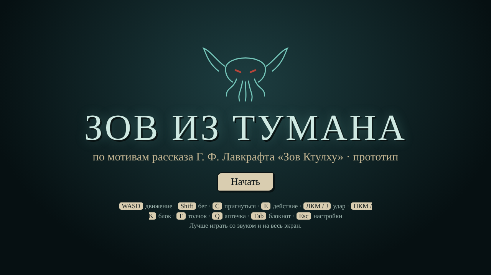
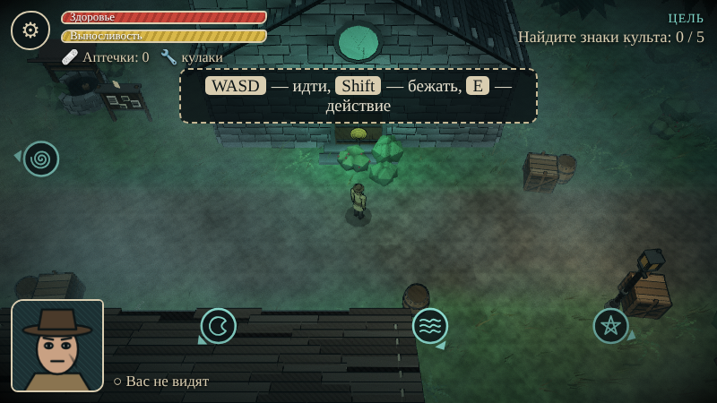
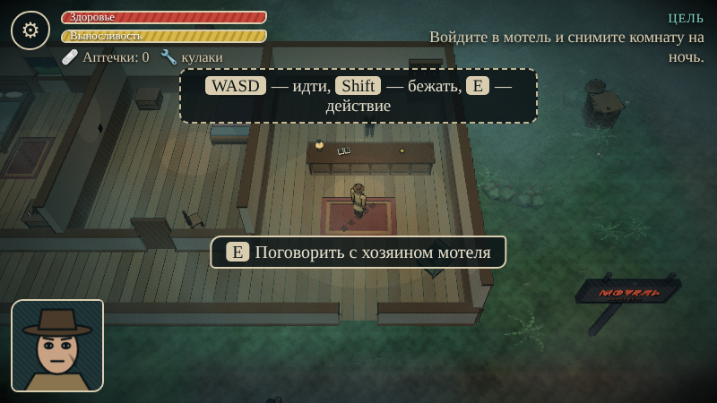
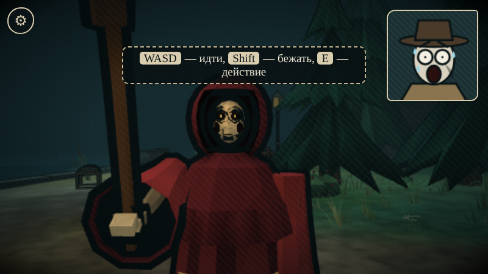
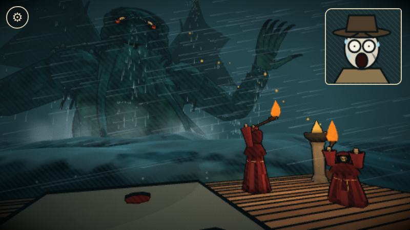
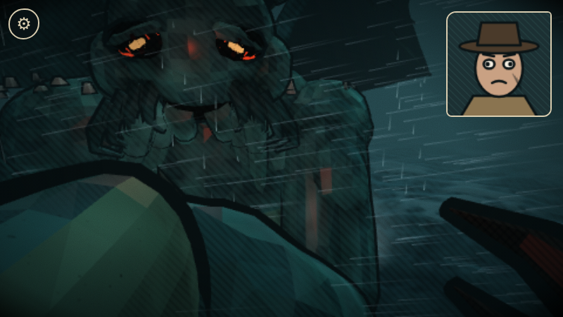

# Зов из тумана

3D-сюжетная хоррор-игра по мотивам рассказа Г. Ф. Лавкрафта «Зов Ктулху». Прототип на 8–10 минут.

Журналист Эдвард Крейн приезжает в рыбацкую деревню Грейхейвен, где по слухам пропадают приезжие. Ночь, туман, мотель на окраине — и подслушанный разговор о том, что он станет следующей жертвой.



## Как запустить

Откройте `index.html` в браузере — игра целиком в одном файле, сборка и сервер не нужны. Лучше со звуком и на весь экран.

Чтобы выложить онлайн: **Settings → Pages → Branch: main, папка / (root)**. Игра откроется по ссылке вида `https://beknazarberikbosyn-dot.github.io/-/`.

## Управление

| Клавиша | Действие |
|---|---|
| WASD / стрелки | движение |
| Shift | бег (тратит выносливость) |
| C | пригнуться — за ящиками, бочками и лодками вас не видно |
| E | действие / осмотреть |
| ЛКМ или J | удар |
| ПКМ или K | блок (вовремя — парирование) |
| F | толчок; после двух ударов подряд — нокаут |
| Q | аптечка |
| Tab | блокнот |
| Esc / ⚙ | настройки |
| колесо мыши | приближение камеры |

## Что в игре

- **Вступление** — поездка через рощу с телефонным разговором, субтитрами и бормотанием вместо голоса.
- **Мотель** — враждебные жители, подслушивание через дыру в стене от первого лица, побег через окно.
- **Деревня** — вид сверху; часовня, кладбище, маяк, рыбный склад, порт. Земля с плавными переходами, трава и кусты колышутся на ветру, объёмный туман клубится и дрейфует сам по себе.
- **Два типа врагов** — жители-«иннсмутцы» с дубинками (с ними можно драться) и культисты в робах с факелами (только бежать или прятаться). Враги медленнее героя и теряют его за кругом обзора.
- **6 загадок от первого лица** — барельеф, кольца-шифр, координаты Р'льеха, звёзды на обелиске, идолы, сейф.
- **7 пасхалок** по «Зову Ктулху» — Некрономикон, профессор Энджелл, «Алерт» и «Эмма», Йохансен, Мискатоникский университет и другие.
- **Финал целиком от первого лица** — удар сзади у сейфа, пробуждение на алтаре, буря с ливнем, молниями и громом, поэтапное пробуждение Ктулху (голова и глаза → крылья → руки с когтями → подъём во весь рост), рука тянется к алтарю, кулак подносит героя к морде и утаскивает под воду.
- **Настройки** — громкость, качество, туман, сложность, размер субтитров, контур, штриховка, тряска экрана.







## Устройство

Все модели (дома, часовня, маяк, мебель, машина, деревья, трава, люди, культисты и Ктулху по частям) сгенерированы скриптом в **Blender** — `tools/zov_lib.py`: процедурные лофты, трубки, шум, подразделение и децимация, запечённое лучами затенение (AO) в вершинах. Экспорт идёт в компактный формат (квантованные вершины + палитра), встроенный в `src/models.js`.

Рендер собственный, на WebGL без библиотек: low-poly с рисованным контуром и штриховкой теней, шейдеры земли и кожи с процедурной текстурой, волны и пена, объёмный туман (ray-march по карте глубины), частицы для дождя, брызг, пузырей и искр, молнии. Звук синтезируется через Web Audio.

### Пересобрать модели

1. Откройте Blender, в Python-консоли или через MCP выполните:
   ```python
   import sys; sys.path.insert(0, '<путь к репозиторию>/tools'); import zov_lib; zov_lib.build_all()
   ```
   JSON-файлы появятся в `~/zov-iz-tumana-assets/`.
2. Скопируйте их в `tools/assets/` и выполните `python3 tools/json2models.py`.
3. Соберите игру: `./build.sh`.

| Файл | Что внутри |
|---|---|
| `src/head.html` | разметка, стили, интерфейс |
| `src/models.js` | модели из Blender (генерируется) |
| `src/1-engine.js` | математика, загрузка моделей, WebGL-конвейер, туман, частицы, звук |
| `src/2-world.js` | земля, вода, растительность, расстановка зданий и реквизита, коллизии |
| `src/3-game.js` | герой, враги, бой, скрытность, HUD, пасхалки |
| `src/4-puzzles.js` | загадки и блокнот |
| `src/5-scenes.js` | кат-сцены, риг Ктулху, буря, финал от первого лица, титры |
| `tools/zov_lib.py` | генератор моделей для Blender |
| `tools/json2models.py` | сборка экспорта Blender в `src/models.js` |
